# Weather station

[Svenska](README.md) · English

A Swedish-language temperature, humidity and home dashboard built with SvelteKit,
Svelte 5 and TypeScript. Weather, Rooms, Audio, Calendar and Car fit the Pi's
1280 × 720 kiosk and adapt to smaller screens. This guide describes the current
installation; documentation is bilingual, while the dashboard interface remains
Swedish. The Swedish README also preserves dated development notes.

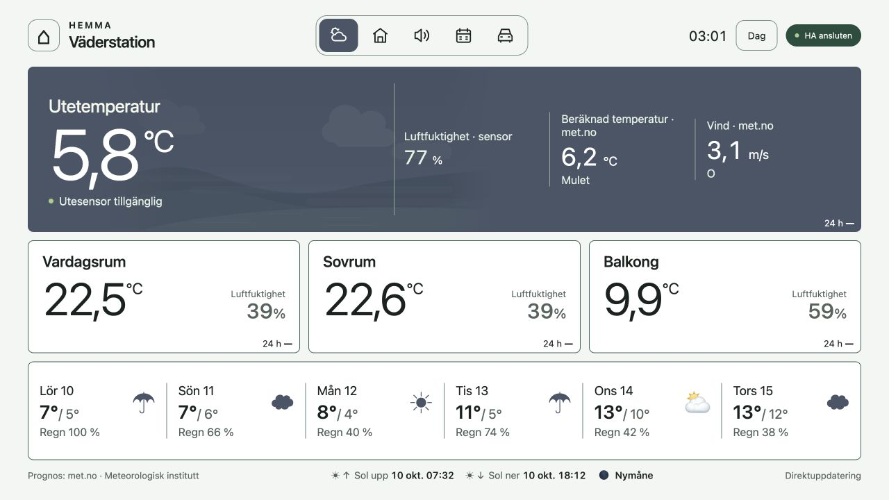

Weather overview in Day mode. Screenshots captured from the dashboard on
2026-10-10 at 1280 × 720; readings and availability are examples from that moment.
The interface remains Swedish in both documentation versions.

Operation verified on Raspberry Pi as of **2026-10-10**.
Dashboard: <http://vaderstation.local:3000/> · Home Assistant: <http://vaderstation.local/>

## Documentation

| Guide                                     | English                                         | Svenska                                      |
| ----------------------------------------- | ----------------------------------------------- | -------------------------------------------- |
| Daily operation, builds and kiosk restart | [Manual operation](DRIFT.en.md)                 | [Manuell drift](DRIFT.md)                    |
| Pi installation and kiosk setup           | [Raspberry Pi](RASPBERRY-PI.en.md)              | [Raspberry Pi](RASPBERRY-PI.md)              |
| Home Assistant migration history          | [Migration](HA-MIGRATION.en.md)                 | [Flytthistorik](HA-MIGRATION.md)             |
| HA and Matter maintenance                 | [HA/Matter](deploy/home-assistant/README.en.md) | [HA/Matter](deploy/home-assistant/README.md) |
| Resource and device health alerts         | [Health checks](deploy/health/README.en.md)     | [Hälsokontroll](deploy/health/README.md)     |
| Nightly USB backup                        | [Backup](deploy/backup/README.en.md)            | [Backup](deploy/backup/README.md)            |
| Restore application data                  | [Restore](deploy/backup/RESTORE.en.md)          | [Återställning](deploy/backup/RESTORE.md)    |
| Developer handover                        | [Handover](HANDOVER.en.md)                      | [Överlämning](HANDOVER.md)                   |

[GEMINI.md](GEMINI.md), [COPILOT.md](COPILOT.md) and [suggestions.md](suggestions.md)
retain historical discussions and review notes in their original language.
They are not current operating instructions. New operational changes should be
reflected in both language versions in the same commit.

## Current installation and architecture

Raspberry Pi 5, 4 GB, Raspberry Pi OS 64-bit desktop, Wayland/labwc and Chromium
kiosk. Three separate Docker containers run the dashboard, HA Container 2026.9.3
and matterjs-server 1.4.0 (matching the former Matter add-on 9.2.0). The Mac's old
HA OS VM is stopped and retained for rollback. Never run it alongside the restored
Pi installation. The Mac is not needed for normal operation.

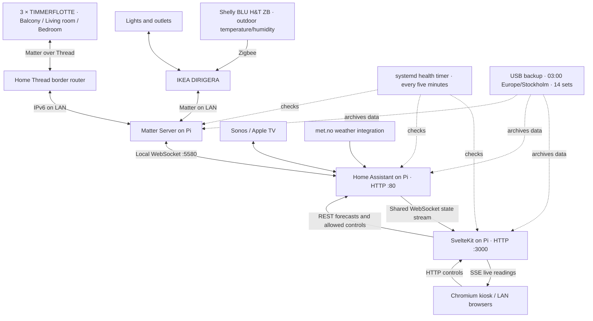

The exact Thread border router carrying each sensor's traffic has not been
verified. Sensors were added to Apple Home and then HA. The dashboard only talks
to HA, never directly to Apple Home, DIRIGERA, sensors or Polestar.

HA/Matter persistent data is under `~/home-assistant/data`; dashboard device
history is in the `device-health-data` Docker volume at `/app/data`. USB backup is
installed and verified. Off-site backup and internet access are not configured.
The local health timer sends Gmail alerts/recoveries but cannot alert during loss
of Pi power.

## Views and behavior

### Weather

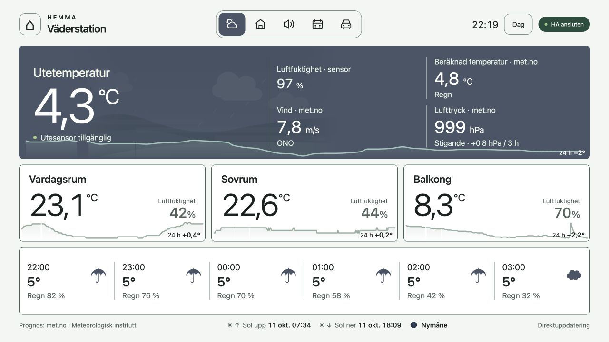

Tap the forecast row to switch from daily to hourly forecasts. The landscape
follows actual sun time even when Day is selected manually.

The dedicated **Shelly BLU H&T ZB** outdoor sensor, connected through DIRIGERA,
provides the primary temperature/humidity reading. Three TIMMERFLOTTE sensors
supply Balcony, Living room and Bedroom. The sensor originally named Kitchen is
mapped to Living room based on confirmed HA areas.

met.no provides comparison temperature (labelled calculated temperature), wind,
pressure and forecasts. Six forecast columns switch between days (min/max) and
hours by tapping the whole row. Precipitation is probability in %, not amount.
`weather/get_forecasts?return_response` retrieves daily/hourly forecasts through
HA, cached in server memory for 15 minutes. Failed forecasts do not block sensors.
The kiosk shows met.no pressure in hPa with the three-hour change and a rising,
falling or stable label. Missing history displays “Trycktrend saknas” (pressure
trend unavailable). Four weather details use a two-column, two-row layout to fit
the 1280 × 720 kiosk. Trend needs Recorder history; missing history, API errors or
current data older than 90 minutes yields no trend.

Weather/Rooms cards show 24-hour temperature curves and change in degrees from
HA Recorder, refreshed every ten minutes and omitted if unavailable. The outdoor
status refers to that sensor; the header status refers to HA connectivity.

The SVG landscape shows a still snapshot of met.no conditions and actual sun
time, including clouds, precipitation, fog and water. As of 23 October 2026,
continuous animation and transitions are removed to reduce Pi rendering load.
The scene refreshes when opened, every ten minutes while visible and when the
page becomes visible again. Wind affects rain slant. Live readings, forecast,
clock and other HA updates keep their existing cadence. There is no remote
weather-video service. SunCalc 1.9 computes sun/moon position and moon phase using
HA's home location cached for one hour. Coordinates remain server-side. Positions
are calculated through SSE at least each minute; the scene samples the latest
positions at its next snapshot without animated interpolation. No guessed
celestial bodies are shown without location. The panorama is stylized, not an
exact view or observation; terrain is not included. After installation, three
five-second samples measured Chromium at 0.4–5.2% and labwc at 0–0.2% of one CPU
core, compared with about 56% + 21% before the change. Temperature was 64–65 °C;
the fan remained at the same stage. Steady-state temperature and perceived noise
still need evaluation.

### Rooms and lighting

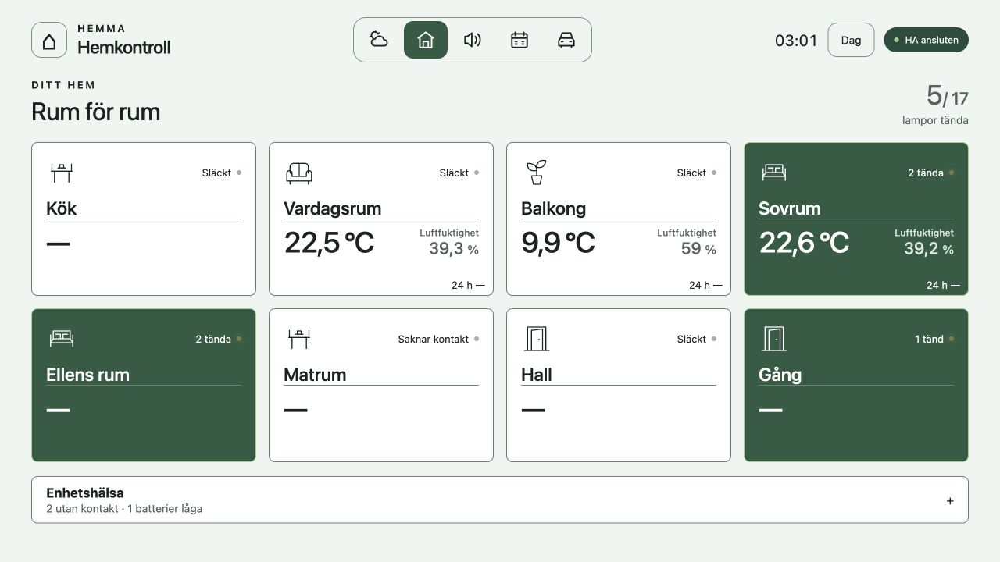

Tap a room card to open its controls. Lit rooms are highlighted; rooms without
sensors show a dash.

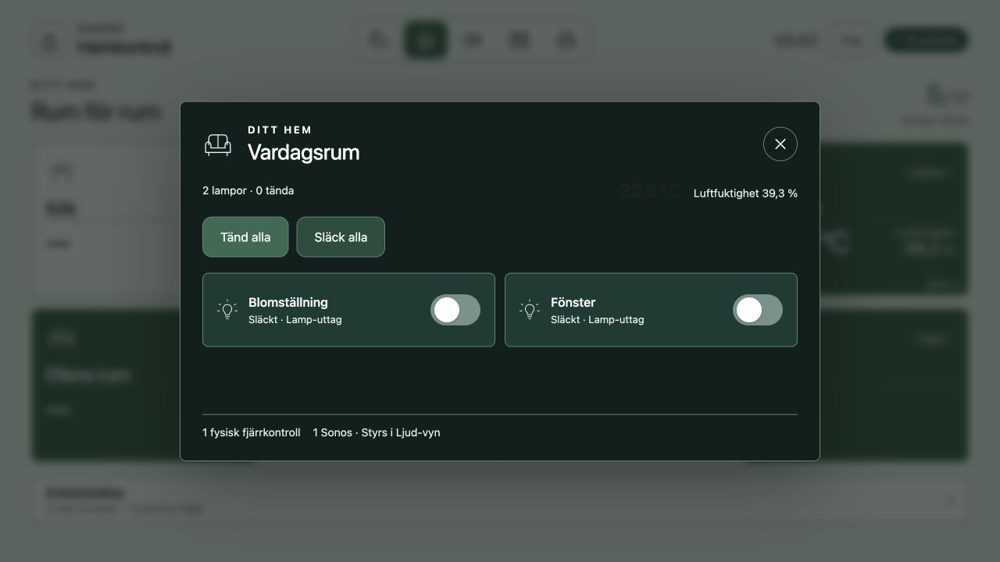

Use individual switches or Tänd alla / Släck alla (all on / all off). Opening the
dialog does not send a command.

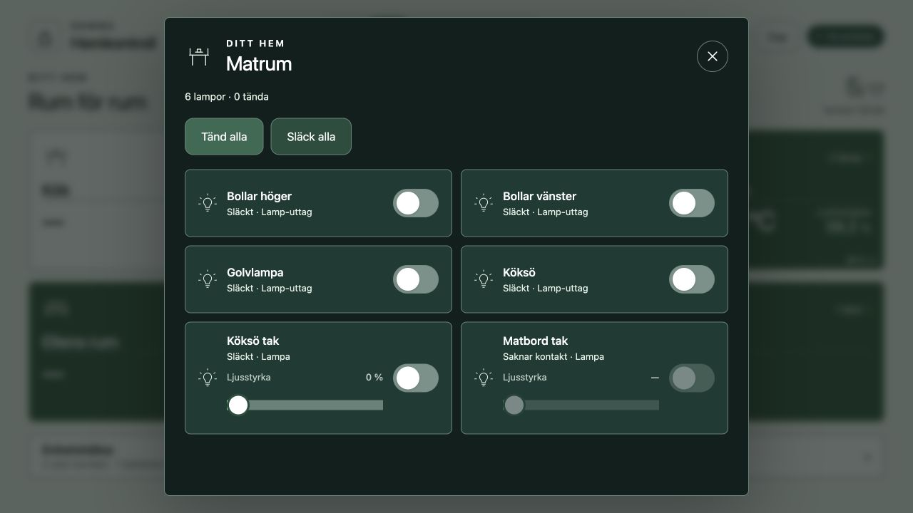

Brightness is available for Köksö tak. Matbord tak illustrates the disabled
controls shown when a light is unavailable. Dragging a working dimmer sends a
command when released.

Cards use HA areas and device/entity registries. Controls include lights and
Matter switches classified as outlets; Sonos/system switches are excluded.
Disabled, hidden and diagnostic/configuration entities are excluded; an entity
area takes priority over its device area. Unassigned devices use “Utan rum”.
Button remotes and Sonos speakers are counted once per device per room.
Whole cards open dialogs with on/off controls and brightness for supported lights,
including HA light groups. Brightness ranges 1–100%; off lights display 0%.
Dragging turns a light on at the selected level; use the on/off control to turn it
off. Commands send on slider release. Outlets do not get dimmer commands;
color/temperature are unchanged. HA reports the confirmed state through the
shared stream. Dialogs show pending commands and errors with reserved feedback
space; successful commands leave no status row.

`/api/home/control` validates known targets and allowed operations. Same-origin
checks and `CONTROL_ALLOWED_ORIGINS` prevent arbitrary origins, but are not login.
Anyone able to access the dashboard on the trusted LAN can control selected lights.

### Audio and Sonos

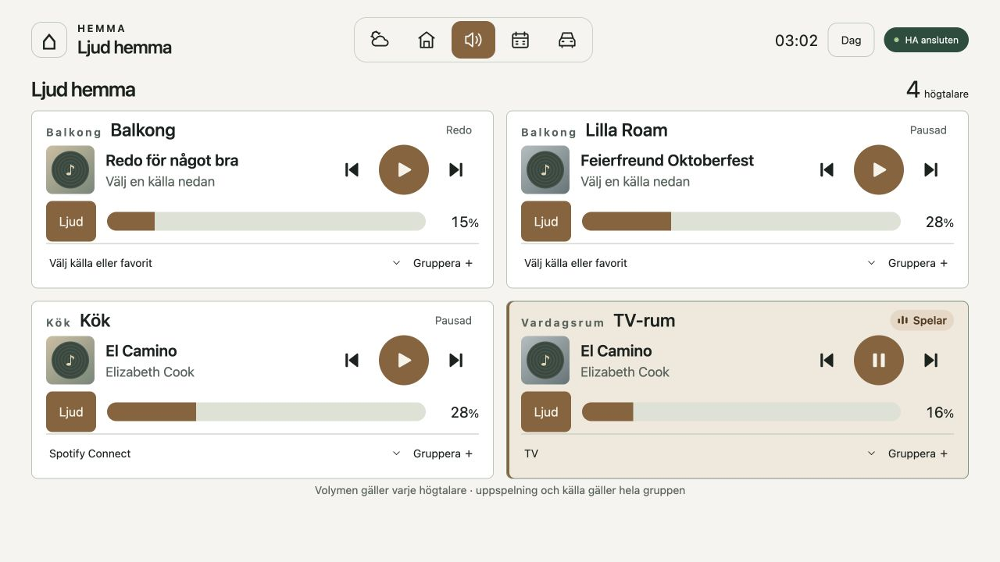

Each speaker has its own volume; playback and source selection follow its group
leader. The TV speaker shows the configured Apple TV metadata.

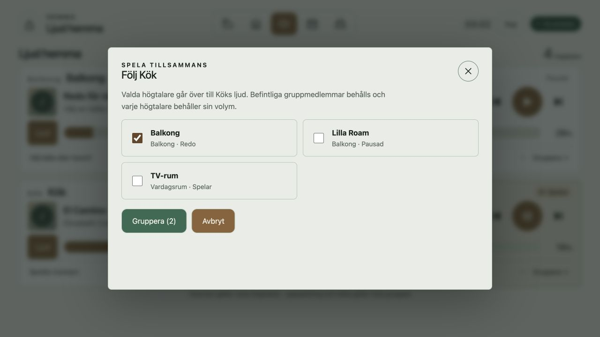

Select speakers, then press Gruppera to apply or Avbryt to cancel. This screenshot
shows a selection only; no grouping command was sent during capture.

Cards show active, visible Sonos media players; Apple TV is excluded as a separate
card. HA area names and device names can differ. Controls include play/pause,
previous/next, mute, per-device volume and sources from `source_list` (favorites,
radio/playlists, TV/Line-in where supported). Source selection may start playback;
accounts and favorites remain managed in the Sonos app.

Grouping adds speakers to the selected player's existing group, using its leader's
audio. Leave removes a speaker. Playback/source commands go to the first member
in `group_members`; volume remains per device. Group state is confirmed only when
HA reports it. `/api/audio/control` validates known Sonos targets, supported
features, volume, source choices and group members. No arbitrary media URLs or
service calls are forwarded. Disconnection blocks controls.

Source commands have a 35-second server timeout; other audio commands 15 seconds;
the client waits up to 45 seconds. Rejection differs from timeout/network failure,
which leaves the outcome uncertain. No automatic retries are sent. A successful
command response does not prove new metadata has arrived.

Optional explicit Apple TV → TV → Sonos metadata mapping uses
`HA_SONOS_TV_ENTITY` and `HA_TV_METADATA_ENTITY`. Leave both blank if unknown.
For the configured Sonos leader's TV source, playing/paused Apple TV with a title
supplies metadata; group members follow their leader. Controls still target Sonos.
If TV input changes while Apple TV continues playing, metadata can be wrong because
TV input status is not integrated. Confirmed mapping:
`media_player.tv_rum_tv_rum` receives TV audio;
`media_player.vardagsrum_vardagsrum` supplies Apple TV metadata.

### Family calendar

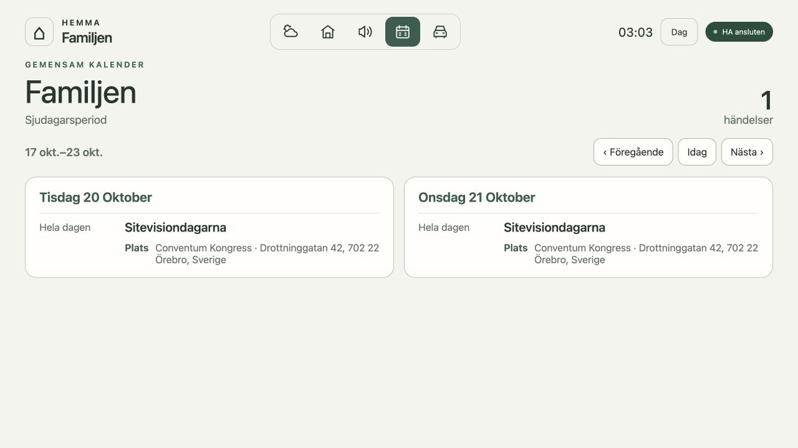

A single two-day event appears on both dates while the total remains one event.
Previous / Today / Next changes the seven-day period.

Only iCloud calendar **Familjen**, exposed in HA through CalDAV as
`calendar.familjen`, is selected; absence is an error. Seven-day periods start
from today in Europe/Stockholm with daylight-saving handling. Previous/Next moves
one period; Today returns to the current period. Only days with events have cards.
HA calendar responses are cached for five minutes. Titles, times, locations and
notes are visible, without clickable text in the kiosk. Annual events with a
`Född 1982` description show age for the event year and hide that line as a note.

Multi-day events appear on each overlapping day; calendar end dates are exclusive.
The event count counts each activity once. Timed events crossing midnight show
From/Until on their start/end days and All day on intervening days. On failure,
an error or last-fetched events with a warning are shown. Apple login and CalDAV
secrets remain in HA. Anyone with access to port 3000 can read calendar content.

### Car: Polestar 2, model year 2025

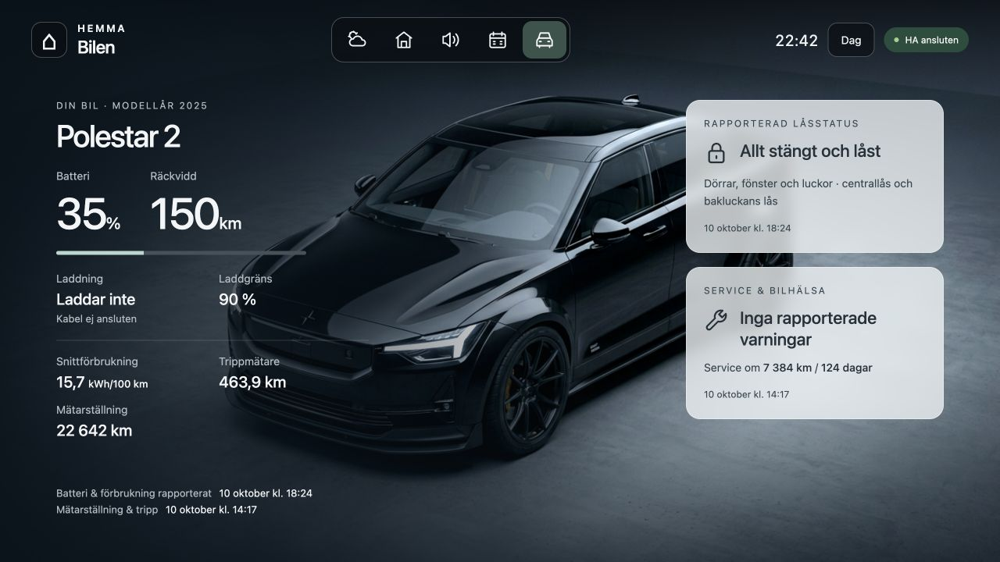

Day mode shows battery/range, charging, consumption, mileage, reported security
and service/health. Independent report times make older data visible.

Uses `static/polestar.jpg` as its backdrop. Battery, range, charging, cable,
charge limit, odometer, average consumption in kWh/100 km, trip meter, service
interval and warnings come from HA's Polestar Data Portal integration. The app
reads fixed `sensor.polestar_*` and `binary_sensor.polestar_*` fields from the
shared HA cache through `/api/car` every 30 seconds while visible. It makes no
additional Polestar calls and sends no car commands. Secrets stay in HA.

Lock status covers four doors, four windows, hood, tailgate, charging flap,
central locking and tailgate locking. All closed/locked requires known secure
values for every field and a valid reporting time. For HA's lock binary sensors,
`on` means unlocked. Unknown values never count as closed. Health warnings cover
brake fluid, coolant, washer fluid, 12 V battery and exterior lighting. Missing
readings are dashes. Battery, security, health and mileage have independent report
times; values older than a day are marked stale.

Status cards use SVG icons: a closed lock for confirmed secure status, an open
lock for open/unlocked, a wrench for service/health and a warning triangle for
reported warnings. A question mark indicates missing data or a connection error;
a clock marks confirmed status older than a day. Icons supplement the text and
are hidden from screen readers. A subtle divider separates charging and driving
data.

The car photo fills the viewport, including behind the top navigation. Dark
gradients protect the text, and menu controls have translucent backgrounds.
On smaller screens, content stacks and the backdrop stays fixed while scrolling.
The photo is scoped to Car and disappears immediately when switching views.

Day mode brightens the photograph and uses light status cards. Night retains the
original treatment; Ambient reveals the car more clearly with a subdued image
and red text. Image brightness is independent of text. Security/health cards use
70% background opacity in Night/Ambient and 78% in Day, with slight backdrop blur.
Text is fully opaque. Normal panel text exceeds 4.5:1 contrast even against a
conservative pure-white backdrop for dark panels or pure-black for the light
panel; blur is not required to achieve that contrast.

Polestar Data Portal 0.3.0 is installed manually in HA outside this repo. The
current credential expires **2026-12-16**; renewal instructions are in
[Manual operation](DRIFT.en.md).

### Navigation, themes and accessibility

<details>
<summary>Car view: Night and Ambient themes</summary>

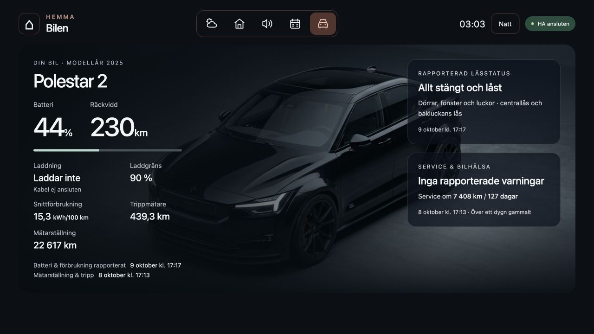

Night uses a dark palette with light text.

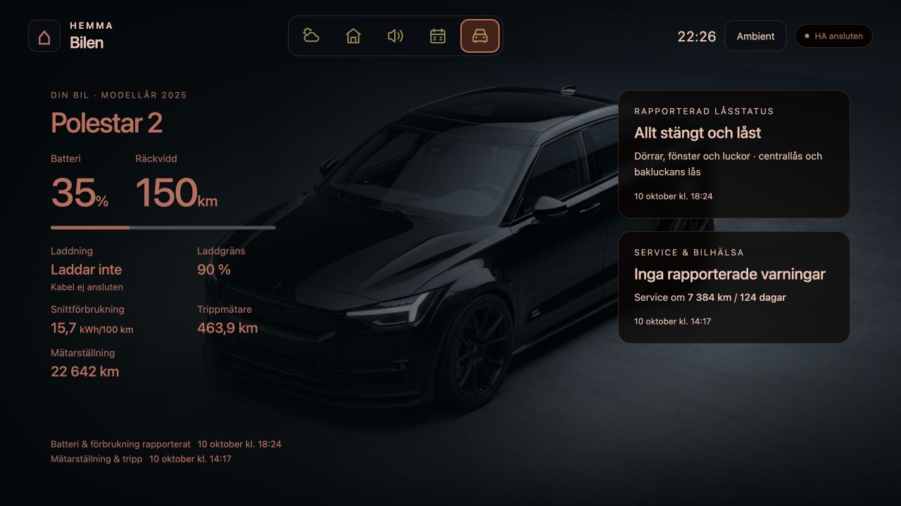

Ambient uses subdued red text; security and health panels retain their own
contrast colors and translucent backgrounds.

</details>

Five inline SVG icons switch Weather / Rooms / Audio / Calendar / Car. Buttons
have Swedish accessible names, hover titles, active `aria-current`, at least
48 × 48 px targets and visible focus. Icons are decorative to screen readers.
The page heading names the selected view. Side swipes move between adjacent views
without wrapping. Vertical scrolling supports long pages/dialogs and touch screens
that emit mouse-like events. On small screens, cards stack and forecasts use two
columns. The Pi kiosk uses `?kiosk=1`, making met.no attribution non-clickable.

After five minutes without interaction, every view returns to Weather and the top
of the page; room/audio dialogs close. Pointer activity, touch, keypresses and
scroll reset the timer. Automatic data updates do not.

The theme button cycles Day → Night → Ambient → Auto; selection persists locally.
Manual modes remain fixed. Auto selects `deep-ambient` **23:00–07:59
Europe/Stockholm**, otherwise sun-driven day/night. Sun event timestamps take
priority, sun state is fallback and absent sun data defaults to Day. Comparisons
use UTC; display time uses Stockholm including DST. An expired schedule is not
extrapolated. During disconnection the last sun state is retained. Manual themes
do not change the landscape's actual day/night, or hardware screen brightness.

### Device health


Expand Enhetshälsa in Rooms and scroll to see contact status, low/unknown batteries
and recent events. This capture shows recovery after the scheduled backup.

Rooms includes monitored lights/outlets, sensors and batteries. The server stores
availability transitions and normal/low/critical battery transitions for 90 days
in `device-health-data`. After restart, HA Recorder reconstructs gaps up to ten
days by default. Short outages may appear in history without causing email.
The Pi's five-minute health timer alerts for physical lights unavailable at least
15 minutes, batteries at ≤30%, again at ≤15%, and recovery. Sensors use the
existing `sensor_data` check to avoid duplicate mail. No auto-repair or re-pairing.
History describes HA reports, not proof of why a device failed. A light stuck `on`
or an unchanged battery value does not prove actual contact. Battery status is
unknown when the associated temperature sensor is offline.

## Server transport and errors

One server-side authenticated `/api/websocket` connection subscribes to
`state_changed`, then loads `get_states`; events received during loading are
buffered. Selected weather, home, audio and car entities are cached in memory;
removed entities leave the cache. Initial server rendering supplies a snapshot;
cold-start readings fill in via `EventSource('/api/events')`. SSE streams selected
normalized data without tokens or unrelated HA entities.

Ping/pong runs every 20 seconds; missing responses reconnect. Startup timeout is
ten seconds; retries back off from one to 30 seconds and reload all states. SSE
sends a heartbeat every 15 seconds and requests three-second reconnect delay.
Forecast timers refresh every 15 minutes even without sensor changes. Closing tabs
cleans up subscribers/timers; the shared HA connection lasts until process exit
or development module replacement. Multiple server processes each create their
own HA connection; current production uses one.

Missing entities, blank values, `unknown`, `unavailable`, invalid numbers or units
yield `null` and display dashes without hiding other readings. Fahrenheit converts
to Celsius; unsupported temperature units are rejected. Humidity requires % and
0–100. Missing configuration and rejected authentication have explicit messages.
Disconnection retains last values with a warning until a fresh state load succeeds;
browser/server loss has its own warning. Reading `updatedAt` is the oldest valid
`last_updated` of its measurements, not proof of last radio contact; no automatic
age cutoff exists for normal sensor readings. `fetchedAt` is server assembly time.

For a future proxy, `/api/events` must stream without buffering or short timeouts;
it sends `X-Accel-Buffering: no` and no-cache headers.

## Technology and configuration

SvelteKit 2, Svelte 5, TypeScript 5, Vite 8, Svelte plugin 7, adapter-node 5,
custom CSS, system fonts and inline SVG. Node 22 is selected by `.nvmrc` and Docker;
`package.json` requires ≥22.12. npm and `package-lock.json` record dependencies.
Prettier with the Svelte plugin handles formatting. No UI library or active mock
provider is used; the retained `mock` label does not enable a demo mode.

Create `.env` from `.env.example` only on first setup, then edit `.env`.

| Variable                                        | Purpose                                                    |
| ----------------------------------------------- | ---------------------------------------------------------- |
| `ORIGIN`                                        | App origin, typically `http://localhost:3000`              |
| `HOME_ASSISTANT_URL`                            | Reachable HA base URL; Pi currently `http://192.168.0.130` |
| `HOME_ASSISTANT_TOKEN`                          | Long-lived HA profile token, server-side only              |
| `HA_OUTDOOR_TEMPERATURE`, `HA_OUTDOOR_HUMIDITY` | Dedicated outdoor sensor                                   |
| `HA_BALCONY_TEMPERATURE`, `HA_BALCONY_HUMIDITY` | Balcony sensor                                             |
| `HA_ROOM_NAME`                                  | Living room label, default `Vardagsrum`                    |
| `HA_ROOM_TEMPERATURE`, `HA_ROOM_HUMIDITY`       | Living room sensor                                         |
| `HA_BEDROOM_TEMPERATURE`, `HA_BEDROOM_HUMIDITY` | Bedroom sensor                                             |
| `HA_WEATHER_ENTITY`                             | met.no, currently `weather.forecast_hem`                   |
| `HA_MOON_ENTITY`                                | Moon integration, currently `sensor.moon_fas`              |
| `HA_SONOS_TV_ENTITY`, `HA_TV_METADATA_ENTITY`   | Optional explicit TV metadata route                        |
| `CONTROL_ALLOWED_ORIGINS`                       | Extra exact origins, comma-separated, no wildcards         |

Confirmed sensor mapping (2026-09-14):

| Location    | Temperature                                         | Humidity                                         |
| ----------- | --------------------------------------------------- | ------------------------------------------------ |
| Balcony     | `sensor.timmerflotte_temp_hmd_sensor_temperature`   | `sensor.timmerflotte_temp_hmd_sensor_humidity`   |
| Living room | `sensor.timmerflotte_temp_hmd_sensor_temperature_3` | `sensor.timmerflotte_temp_hmd_sensor_humidity_3` |
| Bedroom     | `sensor.timmerflotte_temp_hmd_sensor_temperature_2` | `sensor.timmerflotte_temp_hmd_sensor_humidity_2` |
| Outdoor     | `sensor.utetemperatur_temperatur`                   | `sensor.utetemperatur_luftfuktighet`             |

Entity IDs may change after pairing/renaming; inspect HA Developer Tools → States.
Suffixes are not room names. `.env` is Git-ignored and excluded from Docker build
context; Compose supplies runtime variables. Never put the token in `PUBLIC_`
variables, client code or documentation. HTTP is used on the trusted LAN; port
3000 has no dashboard login. Allowed origins are CSRF protection, not authentication.

## Local development

```sh
git clone https://github.com/rosieboy/weather-station.git
cd weather-station
nvm use
npm ci
cp .env.example .env # Only if .env does not already exist!
# Fill in .env with your own configuration.
npm run dev -- --open
```

Open <http://localhost:5173/>. Development can run alongside Docker on port 3000.
Development changes appear immediately; Docker needs a rebuild.

| Command                | Purpose                                                  |
| ---------------------- | -------------------------------------------------------- |
| `npm test`             | Automated model and transport tests                      |
| `npm run check`        | Svelte/TypeScript checks                                 |
| `npm run build`        | Build production server into `build/`                    |
| `npm start`            | Run build, reading `.env` if present; normally port 3000 |
| `npm run preview`      | Preview via Vite                                         |
| `npm run format`       | Format project                                           |
| `npm run format:check` | Check formatting                                         |

Stop Docker before `npm start`, or choose another port, for example
`PORT=3001 ORIGIN=http://localhost:3001 npm start`.

Key files: `src/routes/+page.svelte` (navigation/weather/SSE/themes),
`src/lib/server/ha-stream.ts` (shared HA transport), `home-model.ts`, `audio-model.ts`,
`car-model.ts` (selection/validation), view components under `src/lib/components`,
and API routes under `src/routes/api`. See [Handover](HANDOVER.en.md).

## Docker operation

```sh
docker compose up -d --build
docker compose ps
docker compose logs -f
docker compose down
```

`down` stops/removes the dashboard container; it does not stop HA/Matter in their
separate Compose project. Following logs stops with Ctrl+C. After editing `.env`,
use `docker compose up -d` to recreate the container. Use sudo on this Pi.

The Dockerfile uses `node:22-bookworm-slim`, `npm ci`, check/build, removes dev
dependencies and copies production files/dependencies into runtime. The base tag
is moving rather than digest-pinned; ARM64/AMD64 builds follow host architecture.
The app runs as `node` on `0.0.0.0:3000`, with `init: true`,
`restart: unless-stopped` and persistent `device-health-data:/app/data`.
Compose has no app healthcheck; the separate systemd monitor performs checks.
If Docker cannot resolve `.local`, use HA's reserved LAN IP. HA `localhost` inside
the dashboard container points to that container, not HA.

## Verification and remaining work

The expanded car implementation passed 49 automated tests, Svelte/TypeScript
checks and production build. It is installed on the Pi and confirmed on the
physical kiosk by the user. Subsequent photo/panel changes passed check/build
and visual checks; panel text contrast was checked across all three themes.
Multi-day calendar display, idle return and reboot operation are confirmed.
USB archive integrity/content is verified, but full disaster restoration to a new
SD card is deferred. Separate off-site backup, local Bluetooth and access outside
the LAN remain unconfigured. AI/voice control is deferred.

Dated dependency audits and earlier Sonos troubleshooting are retained in the
[Swedish history](README.md); they are not current security or reliability guarantees.
No CI is configured. Avoid sending live light/Sonos commands solely for UI tests.
