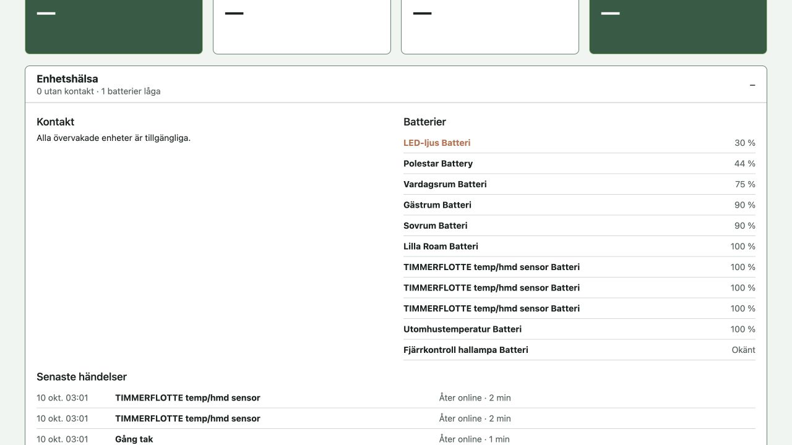

# Health checks on the Pi

[Svenska](README.md) · [English documentation](../../README.en.md)

Installed and verified on 2026-09-23. The timer is enabled; its first run completed
at 20:55 CEST with all 11 checks passing. Email requires the separate setup below
and is enabled in this installation. No automatic restart or repair is performed.

## Installation

```bash
cd ~/weather-station
sudo bash deploy/health/install.sh
```

Validates systemd files, enables the timer and runs the first check. An active
alert is saved/sent normally and does not fail the systemd service. An actual
execution error stops installation and appears in the journal. Runs three minutes
after boot, then five minutes after each completed check.

## Checks and alert behavior

- Root disk: at least 3 GiB free and less than 85% used.
- Available memory (`MemAvailable`): at least 300 MiB; Linux disk cache does not
  count as a memory shortage.
- CPU temperature: below 80 °C.
- Current undervoltage, frequency limiting and throttling via `vcgencmd`.
  Historical flags are informational and do not cause permanent alerts.
- Dashboard, HA and Matter containers are running and not unhealthy/starting.
  Increased restart counts are noted; comparisons reset on container replacement
  or Pi reboot.
- HTTP responds on ports 3000, 80 and 5580.
- Dashboard SSE delivers a snapshot within eight seconds without HA connection errors.
- Outdoor, Balcony, Living room and Bedroom readings have numeric temperature
  and humidity values.
- Dashboard `/api/device-health`: Matter lights/outlets unavailable for at least
  15 minutes; batteries at or below 30% (warning) and 15% (critical). These two
  checks alert on the first five-minute run after crossing the threshold.
  Recovery above 30% gives RECOVERED; low-to-critical gives a new ALERT.

Other checks require three consecutive failures for ALERT (about 10–15 minutes).
Continued failures do not repeat ALERT; the first successful check gives RECOVERED.
Every run logs a brief summary. Established alerts return exit code 0 because the
check itself completed; alerts remain visible in the status file, journal and
email. Unexpected script errors fail the service; the timer still runs again.

Unchanged readings are not errors. Checks cannot prove regular sensor reporting
when HA retains an old valid value. Power status of Lilla Roam, Samsung and other
devices is not checked. Backup age is not monitored. [USB backup](../backup/README.en.md)
runs separately; inspect `last-success.json` and its service journal.

Device events appear in Rooms and persist for 90 days in the `device-health-data`
Docker volume. HA Recorder reconstructs missed events after app container rebuilds.
If Pi and HA remain off longer than retained Recorder history (normally ten days),
the gap cannot be reconstructed. `device_monitor` also reports history-query errors.

## Status and logs



Device health is in Rooms. It shows HA-reported contact status, batteries and
events; read the systemd timer’s resource-check status with the commands below.

```bash
systemctl list-timers weather-station-health.timer
sudo systemctl start weather-station-health.service
journalctl -u weather-station-health.service -n 30 --no-pager
sudo cat /var/lib/weather-station-health/status.json
```

Latest readings and alert counters are in `status.json` in a private directory.
The check uses no HA token, stores no entity values and makes no external network
calls for checking. Optional mail delivery uses SMTP. It runs as root for Docker
inspection and `vcgencmd`; Docker socket access gives root capability despite
systemd hardening. Only run trusted code here. No watchdog or external uptime
monitor is included; a powerless Pi cannot check or alert.

Disable with `sudo systemctl disable --now weather-station-health.timer`.
To change thresholds/container names, edit `pi-health.py` and rerun `install.sh`.

## Gmail delivery (enabled 2026-09-24)

SMTP uses sender redaretorget@gmail.com and recipient androsen@gmail.com.
Setup and actual delivery were verified on 2026-09-24 at 20:53 CEST. On reinstall,
run `install.sh` with sudo, then `sudo python3 deploy/health/configure-mail.py`
from the repository root. The app password is entered hidden and saved at
`/etc/weather-station-health/smtp.json` with mode 0600. Never commit it or send it
in chat.

The first run after setup sends a startup message. New ALERT/RECOVERED events are
saved in the status-file outbox before delivery, batched into one email per run
via smtp.gmail.com:587 with verified STARTTLS, and removed after successful sending.
Failures retry on the next check. A crash between sending and saving can duplicate
an email. Older journal events are not sent retroactively. Without SMTP setup,
local checks continue. Emails include HTML and plain text; times use Europe/Stockholm.

```bash
sudo bash deploy/health/install.sh
sudo python3 deploy/health/configure-mail.py
sudo systemctl start weather-station-health.service
journalctl -u weather-station-health.service -n 10 --no-pager
```

Retry/TLS tests used simulated SMTP. Actual Gmail delivery is verified: the user
received READY, the journal showed Mail delivered, the queue was empty and the
timer active. No permanent SMTP process or additional container is needed.
